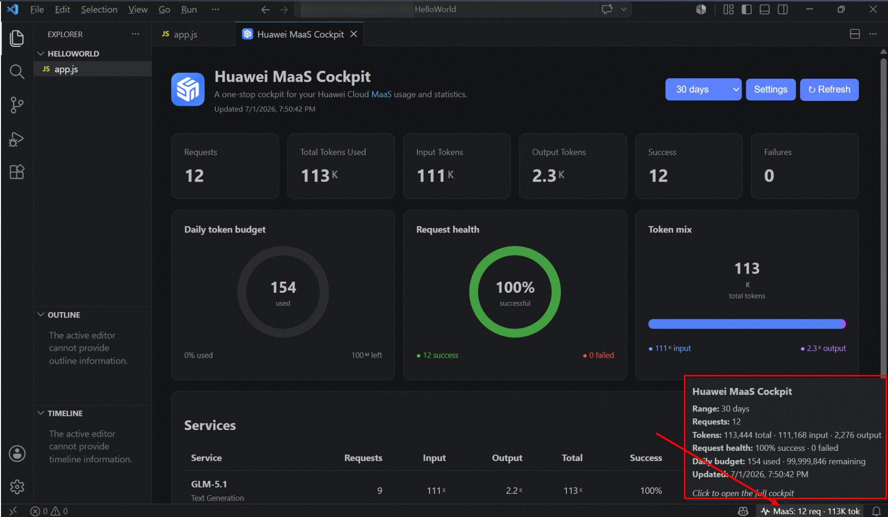

# Huawei MaaS Cockpit

Monitor Huawei Cloud ModelArts MaaS usage from VS Code. A request counter appears on the right side of the status bar; click it for requests, token totals, success/failure counts, and per-service statistics.

## Setup

1. Sign in to the Huawei Cloud international console.
2. Copy Project ID of your Huawei Cloud account of `Hong Kong` Region.
3. In browser developer tools, copy the full `Cookie` request-header value from an authenticated ModelArts MaaS request.
4. Press `Ctrl+Shift+P` and run **Huawei MaaS: Configure Credentials**.
5. Enter the project ID and paste the cookie.
6. Enter the Cookie. 

The cookie is kept in VS Code Secret Storage, never settings or logs. Browser sessions expire, so reconfigure when prompted.

Commands: **Open Cockpit**, **Configure Credentials**, **Refresh Statistics**, and **Clear Credentials**. Settings control region, timezone, refresh interval, and console URL.

> This uses Huawei console endpoints and a browser session. Treat the cookie as a password. Prefer a documented public API if Huawei provides an equivalent endpoint.

Developed with <3 by Fawad Iqbal f00928374 for you.
